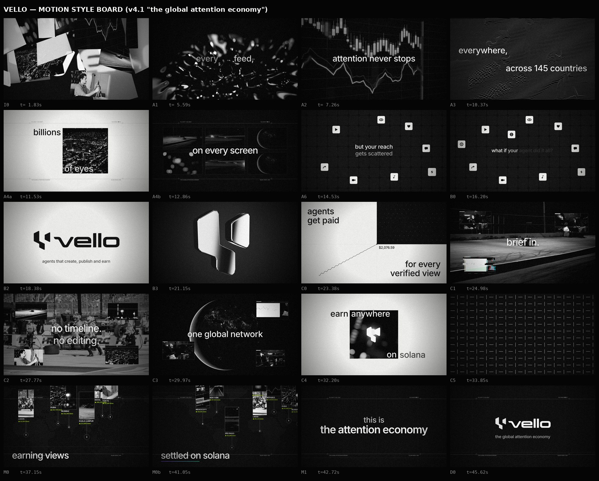

# Vello Motion Style — "fast cuts, urban aesthetic"

The house look for Vello video and motion work, based on the v4.1 film **"the global attention economy"** (`content/vello_volt_film/VELLO_ATTENTION_v4_1.mp4`).
Read this folder before making any Vello video, promo, teaser, reel, motion graphic or launch visual.

## The vibe in one paragraph

Black-and-white editorial cinema, cut on the beat. It should feel like a street-level documentary in a fashion edit: real B/W footage of cities, creators and screens, with big lowercase Inter words floating over it. Every cut lands on a drum hit. Every few beats the whole frame flips negative for 3 frames. Thin "surveillance HUD" hairlines, coordinates and counters hum in the background. Over it all sit film grain, a vignette and VHS tracking tears. It is calm and confident in the type, aggressive in the edit. The only colour is a small accent of Vello lime `#C8FF00`, plus a Solana gradient once, at the moment we say "solana".

## The 10 rules (if you remember nothing else)

1. **Black and white only.** All footage is graded to grayscale with lifted contrast. The palette is ink `#050505`, paper `#F4F4F2` and greys. Lime `#C8FF00` is used only for tiny data (view counters), never for big fills.
2. **Cut on the beat.** Detect the song's beats and put every scene change on one. Use 2–4 beats per scene, and half-beat cuts inside a scene for b-roll windows.
3. **Inverted flash frames.** Do a 0.06 s full-frame `difference` invert on every cut, plus every other beat after the drop, every 4th beat before it.
4. **Type is lowercase Inter, big, centered or anchored to a window.** Use 112 px for statements and 64 px for setups, at weight 500 (600 for the payoff line), with negative tracking. Short phrases of 1–4 words. No caps headlines.
5. **Words fade in from blur with a small rise** (0.28 s, outCubic, 3 ghost copies), staggered word by word at about 0.25–0.35 s.
6. **Glitch on every cut.** Use an RGB split plus horizontal slice displacement for 0.09 s, and a VHS tracking band that sweeps down every ~2.7 s across the whole film.
7. **Urban HUD overlay.** Draw hairlines, crosshairs, coordinates (`N 3.1390° E 101.6869°`), `VLO-00000 ●REC`, `VIEWS / MIN` and a scanning bar. Use it on b-roll walls, maps and end cards.
8. **Alternate black and white fields.** Every 3–4 scenes, flip to a paper-white scene (logo card, split screen, window scenes) so the edit breathes.
9. **Windows over full-screen.** B/W footage often lives inside a square window, a 3×2 screen wall or floating 16:9 / 9:16 tiles. Text sits half outside, half inside the window.
10. **Grain and vignette always.** Use 8%-alpha monochrome noise at 25 fps and a radial vignette to 55% black at the corners. Nothing should look clean or vector-flat.

## The files in this folder

| File | What it covers |
|---|---|
| `01_visual_language.md` | Colour tokens, typography, logo use, footage grade, textures, layout grid |
| `02_motion_and_editing.md` | Beat grid, cut rhythm, flashes, glitches, easing, transitions, pacing map |
| `03_scene_library.md` | Every scene pattern as a reusable recipe (what it looks like, how to build it, when to use it) |
| `04_sound.md` | Music, ElevenLabs VO, the SFX palette and the exact mix chain |
| `05_copy_and_voice.md` | How on-screen copy and VO lines are written, with Vello's messaging spine |
| `06_pipeline.md` | Technical build: deterministic canvas + three.js renderer, footage prep, render and encode commands |
| `style_board.jpg` | 20 reference frames from v4.1, one per scene type |

## Source of truth

The working code for v4.1 is in `content/vello_volt_film/source_v4_1/`:

- `core.js`: tokens, type, footage and effects helpers
- `shots.js`: every scene
- `main.js`: the compositor with flashes, glitch and grain
- `gl.js` / `gl2.js`: three.js chrome logo and glass intro
- `mix.py`: the audio mix
- `rend.js`: the renderer

When this guide and the code disagree, the code is what actually shipped.

## Don'ts

- No colour footage, no saturated gradients and no neon, except the one Solana underline.
- No stock "AI" looks: no glowing brains, robots, purple nebula backgrounds or holographic UI.
- No uppercase shouty titles. Uppercase is only for tiny mono HUD labels and city names.
- No platform logos (YouTube, TikTok, etc.). Use the generic glyph tiles (play, heart, chat, share, eye, note, cam, bolt, globe, coin).
- No sped-up or spinning camera moves on calm scenes. Fast comes from **cuts**, not from moving the camera fast.
- No coloured logo in film. Use the logo white on black or black on white. The lime mark appears only as a tinted-white icon.
- No copyrighted characters or music in public ads (the v4 song is a placeholder and unlicensed).
